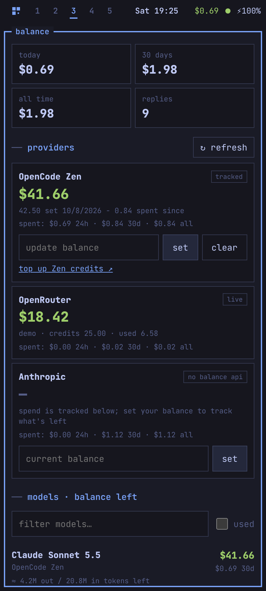
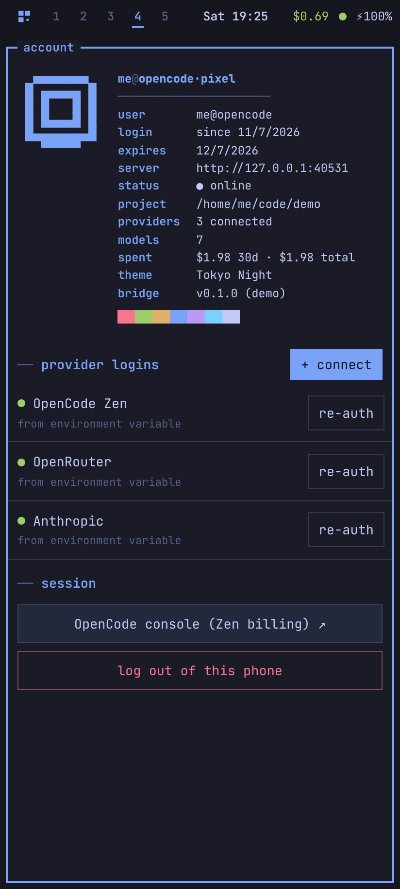
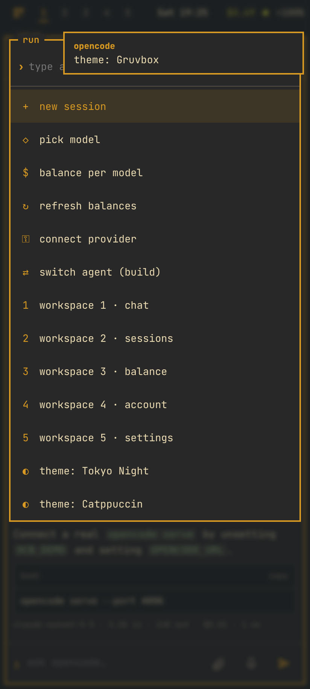

# opencode·pixel

A phone app for [opencode](https://opencode.ai), built for the **Pixel 9** and styled like the
**Omarchy** desktop (Hyprland tiles, Waybar, Walker launcher, mako toasts, Tokyo Night by default).

Chat with your coding agent from your phone, log in to model providers, and see **how much
balance you have left for each model**.

<p>




</p>

## What it does

| Workspace | What's there |
|---|---|
| **1 · chat** | Streams replies live. Shows tool calls (bash, edit, read…), thinking, todos, and the cost and tokens of each reply. Approve or reject permission requests. Switch model and agent (build / plan). Stop a reply. Attach photos or PDFs (big camera shots are shrunk first). Dictate by voice. `/commands` run opencode commands. |
| **2 · sessions** | All your opencode sessions. Filter, rename, share, delete. |
| **3 · balance** | Spend today / 30 days / all time. **Balance per provider** and **balance left per model**, with rough tokens left at list price. Spend per model over 5 h / 24 h / 7 d / 30 d. Optional per-model monthly limits that work like OpenCode Go (5 h = 20 %, week = 50 %). |
| **4 · account** | A fastfetch-style card: who's logged in, which server, project, spend. Your provider logins (OAuth or API key, keys masked). **Connect a provider** from the phone. Log out. |
| **5 · settings** | 9 Omarchy-style themes, text size, haptics, "reply finished" notifications, keep screen on while working, enter-to-send, install button. |

On the phone: **swipe left/right to change workspace**, tap the grid icon or the clock for
the launcher, use the Android back gesture to close sheets. Share text from any app to
"opencode" and it lands in a new chat. Long-press the home-screen icon for shortcuts.
Turned sideways (or on a Fold), chat tiles next to the workspace you picked.

### Where balances come from

opencode records the cost of every reply, so **spend is tracked for every provider**. What's
*left* comes from the best source available:

| Provider | Balance |
|---|---|
| OpenRouter, DeepSeek, Moonshot (Kimi), SiliconFlow | **Live** from the provider's balance API, using the key opencode already has. |
| OpenCode Zen, Anthropic/OpenAI API keys, anything else | No public balance API, so type in your balance once (from opencode.ai/console). The app subtracts what opencode has spent since then. Update it after you top up. |
| Claude Pro/Max, ChatGPT, GitHub Copilot logins | Shown as a subscription plan. |

Per model, "balance left" is the provider's balance, capped by any monthly limit you set on
that model.

## How it fits together

```
Pixel 9 (installed web app)  ──HTTPS (Tailscale)──▶  bridge (this repo, Node)  ──▶  opencode serve
                                                      │ login, balances, proxy        │ your agent
                                                      └ reads ~/.local/share/opencode/auth.json (keys never sent to the phone)
```

The bridge and opencode run on your computer (e.g. your Omarchy machine). The phone talks
only to the bridge.

## Set up

You need Node 20+ and opencode on the computer, and [Tailscale](https://tailscale.com) on the
computer and the Pixel (the app needs HTTPS to install, notify and use the mic).

```bash
git clone https://github.com/jrpixel666/opencode ~/opencode-pixel
cd ~/opencode-pixel
cp .env.example .env        # set OCB_PASSWORD (and OPENCODE_SERVER_PASSWORD if you use one)

# 1. start opencode in your project
cd ~/code/my-project && opencode serve --port 4096 &

# 2. start the bridge
cd ~/opencode-pixel && npm start

# 3. give it an HTTPS address on your tailnet
tailscale serve --bg 7878
```

Then on the Pixel: open `https://<computer>.<tailnet>.ts.net` in Chrome, log in, and choose
**⋮ → Add to Home screen → Install** (or the install button in settings).

To keep it running on Omarchy / Arch, use the systemd user units in [`deploy/`](deploy/):

```bash
cp deploy/*.service ~/.config/systemd/user/
systemctl --user daemon-reload
systemctl --user enable --now opencode-serve opencode-pixel
loginctl enable-linger "$USER"
```

Edit `WorkingDirectory` in `opencode-serve.service` to your project first.

### Try it without opencode

```bash
npm run demo     # http://localhost:7878  ·  login: me / demo
```

Demo mode uses a built-in fake opencode server with sample sessions and balances.

## Security

The app can do anything opencode can, including running shell commands on your computer.

- Keep the bridge on `127.0.0.1` and reach it through Tailscale. Don't open the port to the internet.
- Pick a long `OCB_PASSWORD`. If you don't set one, a random password is created and printed when the bridge starts.
- Logins are signed, HttpOnly, SameSite=Strict cookies. Failed logins are rate-limited.
- Provider keys stay on the computer. The phone only ever sees masked hints like `sk-o…3456`.
- Protect opencode itself with `OPENCODE_SERVER_PASSWORD`. The bridge passes it on for you.

## Settings

All in `.env` (see [`.env.example`](.env.example)):

| Variable | Default | |
|---|---|---|
| `OCB_USERNAME` / `OCB_PASSWORD` | `me` / generated | Login for the phone app |
| `OCB_HOST` / `OCB_PORT` | `127.0.0.1` / `7878` | Where the bridge listens |
| `OCB_SECURE_COOKIES` | off | Set `1` when served over HTTPS |
| `OCB_SESSION_DAYS` | `30` | How long a phone stays logged in |
| `OPENCODE_URL` | `http://127.0.0.1:4096` | The `opencode serve` address |
| `OPENCODE_SERVER_USERNAME` / `_PASSWORD` | `opencode` / none | opencode's basic auth |
| `OPENCODE_DIRECTORY` | none | Project directory to pin |
| `OPENCODE_AUTH_FILE` | `~/.local/share/opencode/auth.json` | For live balances and key hints |
| `OCB_DEMO` | off | `1` = built-in fake opencode |

Balances and limits you type in are saved in `data/budgets.json`.

## Development

No dependencies, no build step. `npm run check` runs syntax checks and the tests.

```
server/   index.js (HTTP + proxy) · auth.js · balances.js · usage.js · opencode.js · mock.js
public/   index.html · style.css · app.js · js/{api,markdown,themes}.js · sw.js · manifest
deploy/   systemd user units
```
