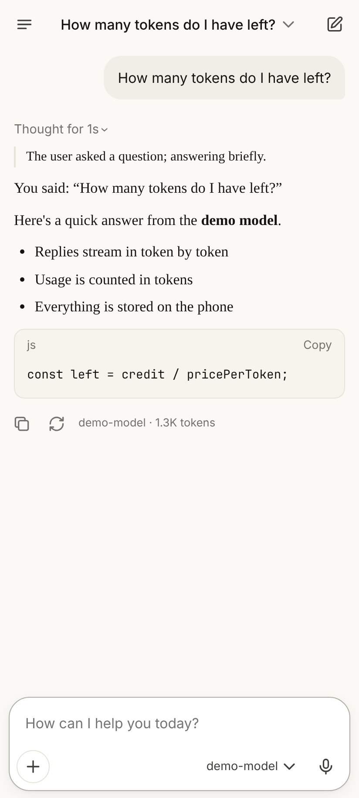
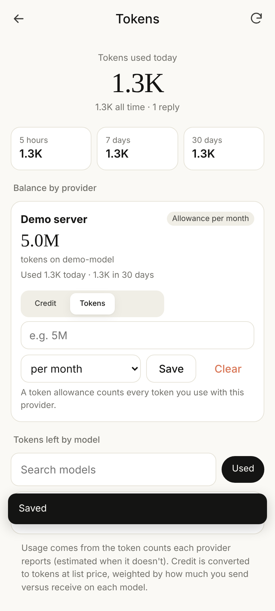
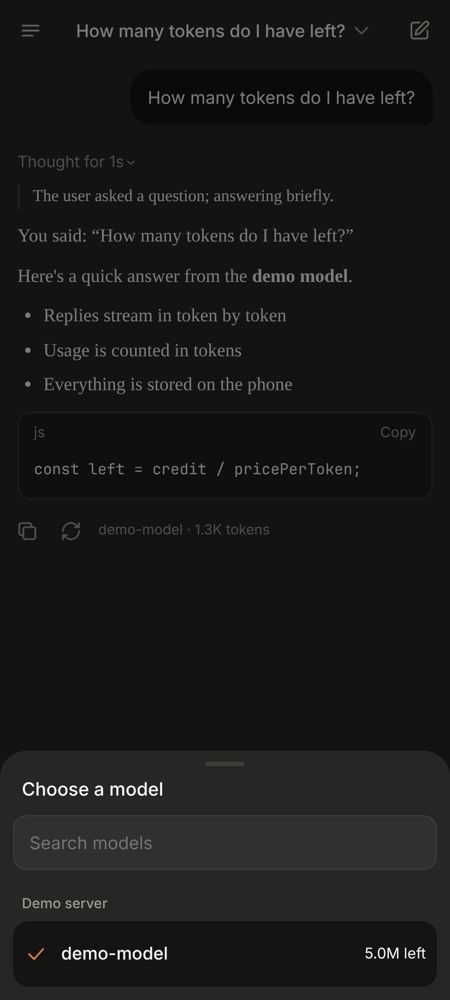
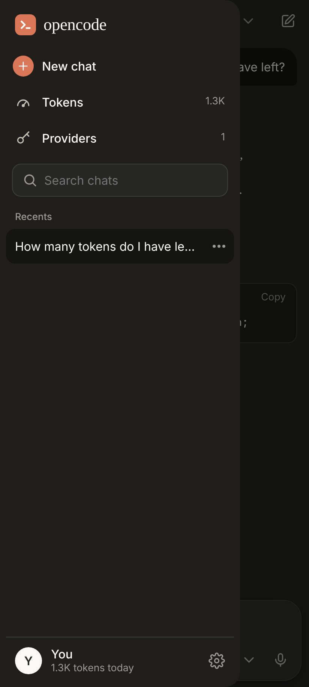

# opencode·pixel

A standalone AI chat app for Android, built for the **Pixel 9**. It runs entirely on your
phone: no computer or server of your own. It talks to model providers directly with your own
API keys and shows your **balance in tokens**, not money.

The design follows the general style of the Claude Android app (ivory and charcoal themes, a
terracotta accent, serif replies). It's an independent project, not affiliated with Anthropic,
and uses its own icon.

<p>




</p>

## Install

1. Download `opencode-pixel-<version>.apk` from **Releases** and open it on your Pixel (allow installing from your browser or Files when asked).
2. Open **opencode** → **Add a provider** → pick one and paste your API key.
3. Choose a model and start chatting.

Android 11 or newer. The app needs internet only to reach the providers you add.

## What it does

- **Chat** with streaming replies, collapsible thinking, Markdown and code blocks with copy, retry, photos from the camera or gallery for models that see images, and Google voice typing.
- **Providers:** OpenCode Zen, OpenCode Go, Anthropic, OpenAI, Google Gemini, OpenRouter, DeepSeek, xAI, Groq, Mistral, Moonshot and about 200 more from [models.dev](https://models.dev), plus **custom servers** (Ollama, LM Studio, anything OpenAI-compatible) on your network.
- **Tokens, not money:** tokens used today / 5 h / 7 d / 30 d, and **tokens left** per provider and per model.
- **Private by default:** chats and token history stay on the phone. API keys are encrypted with the Android Keystore and only ever sent to that provider's own servers.
- **Phone touches:** light/dark following the system, back gesture, swipe for the drawer, share text from any app into a chat, launcher shortcuts, notifications when a reply finishes in the background, keep screen on while replying, export/import chats.

### How "tokens left" works

Every reply's token count (as reported by the provider, or estimated if it doesn't say) is
recorded on the phone. What's *left* comes from, in order:

| Source | How |
|---|---|
| **Live credit** | OpenRouter, DeepSeek and Moonshot report your credit; the app reads it with your key. |
| **Your credit** | For providers with no balance API (OpenCode Zen, Anthropic, OpenAI…), enter the credit shown in their console once; the app subtracts what you've used since. |
| **Token allowance** | Or give a provider a token allowance (e.g. 5M per month) and the app counts down. |
| **Model limit** | Optionally cap any model (e.g. 2M per day). The smallest of these wins. |

Credit becomes tokens at each model's list price (from models.dev), weighted by how much you
send versus receive on that model. Free models show "Free".

## Build

```bash
npm test                         # unit tests (stream parsers, token maths, catalog)
npm run preview                  # run the interface in a desktop browser, with a fake model
npm run catalog                  # refresh the bundled model list from models.dev

cd android && gradle assembleRelease   # needs JDK 17+, Gradle 8.14, Android SDK 35
```

See [`android/README.md`](android/README.md) for signing and release details.

```
android/app/src/main/java/…/MainActivity.java   WebView host, network bridge, camera, voice, files
android/app/src/main/java/…/KeyStore.java       API keys, encrypted with the Android Keystore
android/app/src/main/assets/web/                the app: index.html, style.css, app.js
  js/catalog.js   providers/models and which API each one speaks
  js/llm.js       request bodies and streaming parsers (OpenAI, Responses, Anthropic, Gemini)
  js/tokens.js    token ledger and "tokens left"
  js/db.js        on-device storage (IndexedDB)
  js/net.js       requests through the native bridge
```

## Releases

Every push runs CI (tests + Android build). When `main` has a version in `package.json` that
hasn't been released, a GitHub release is published with the APK attached (needs the signing
secrets described in `android/README.md`). To ship: bump `version`, add a `CHANGELOG.md`
section, merge.
